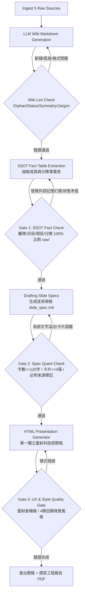

# AGENTS.md - NCT LLM Wiki & Pedagogical Presentation Engine

## 1. 專案使命 (Project Mission)
本專案依據 Karpathy 的 LLM Wiki 架構與課堂講義（第 26 頁「大圈很少轉，小圈轉得很快：錯誤要在離源頭最近的地方被抓到 (Shift-Left)」與第 52 頁工程標準），建立一套高可靠度的「NCT 體制與發展歷史」知識庫，並將其轉譯為一份專供**完全不懂 K-Pop 的路人（Zero-Knowledge Audience）**輕鬆理解的教學型 HTML 互動簡報。

---

## 2. 系統架構與 Loop / Graph 設計 (System Architecture)

---

## 3. 核心設計原則：Shift-Left 與雙重小圈閘門

### 3.1 為什麼要 Shift-Left（左移）？
- **傳統反模式（轉大圈）**：直接從 Wiki 生成整份 HTML 簡報，發現成員狀態過時或排版破版後，整份重跑。耗費龐大 Token，且容易引發「改對 A 頁、改壞 B 頁」的副作用。
- **工程最佳實務（轉小圈）**：
  1. **Gate 1（SSOT 事實閘門）**：在生成簡報大綱前，強制抽取《NCT 成員與分隊 SSOT 事實表》，直接卡死每位成員的狀態標籤（`active` / `inactive` / `former`）與異動年月，100% 依據 `raw_sources/`，嚴禁調用 LLM 舊訓練記憶。
  2. **Gate 2（Spec 量化規格閘門）**：在渲染 HTML 前，透過逐頁規格文件（`slide_spec.md`），以程式腳本檢查單頁字數（≤ 120 字）、卡片數（≤ 4 張）、Wiki 來源標記，杜絕文字溢出（Overflow）導致破版。

---

## 4. 模組職責分工 (Roles & Responsibilities)

| 模組 / Agent 角色 | 輸入 | 輸出 | 核心檢查標準 (Gate) |
| :--- | :--- | :--- | :--- |
| **Ingestion Agent** | 外部權威資料 / 歷年紀錄 | `raw_sources/*.md` (5 篇) | 必須涵蓋 2016-2026 體制演進、最新成員異動、SM 3.0 改革宣告 |
| **Wiki Builder Agent** | `raw_sources/` | `wiki/` (concepts, units, members, timeline, glossary) | 通過 `lint_wiki.py`：無孤島頁面、雙向連結對稱、術語有白話定義 |
| **SSOT Fact Extractor** | `wiki/` | `specs/ssot_facts.json` / `.md` | 通過 Gate 1：成員現役/兵役/離隊年月與分隊歸屬無幻覺 |
| **Slide Spec Planner** | `specs/ssot_facts.md` + `wiki/` | `specs/slide_spec.md` | 通過 `lint_spec.py`：字數 ≤ 120 字、卡片 ≤ 4、附帶 `[來源: wiki/...]` |
| **Deck Renderer Agent** | `specs/slide_spec.md` | `presentation/index.html` | 單檔運作、內建雷射香檳綠樣式、各隊回歸風格、響應式防破版 |
| **Audit & Report Writer** | 全流程紀錄 | `report/final_report.md` | 符合 9~10 分標準：含具體錯誤案例、Shift-Left 流程圖與反思 |

---

## 5. 品質與格式防錯標準 (Lint Rules)

1. **孤島頁面檢查 (Orphan Check)**：所有成員、分隊或概念頁面必須至少被 1 個其他頁面引用。
2. **狀態一致性 (Status Consistency)**：標註為 `former` 的成員，分隊列表中必須明確註明離開年份，不可出現「現任」矛盾。
3. **雙向連結對稱性 (Bidirectional Symmetry)**：分隊列出成員 A，成員 A 的頁面必有該分隊連結。
4. **路人友善術語前置 (Term Pre-definition)**：所有 K-Pop 行話（如「回歸」、「打歌」、「初一位」、「直拍」）在正文出現前必須在 Glossary 定義，並在簡報中具備輔助說明。
5. **簡報規格量化防破版 (Slide Quant Bounds)**：
   - 每頁內文字數 ≤ 120 字（中文字符）。
   - 每頁資訊卡片 / 核心區塊 ≤ 4 個。
   - 每頁標記 `來源: wiki/xxxx.md` 以供溯源。

---

## 6. 視覺規範 (Visual Guidelines)

- **主色調**：NCT 官方應援色 **Pearl Neo Champagne (珍珠香檳綠 `#B4E858` / `#C7F464`)**，搭配冷冽黑底（`#0B0D10`）、雷射全息（Holographic）流光與科技感玻璃擬態（Glassmorphism）。
- **分隊回歸章節特化視覺**：
  - **NCT 127**：*Fact Check*（首爾科技感、宮殿金色金屬光澤、霸氣高對比）。
  - **NCT DREAM**：*We Go Up*（街頭少年活力、動態線條、高飽和綠/白光）。
  - **WayV**：*Turn Back Time*（時空暗黑科幻、齒輪鐘錶機械光澤、暗紅與深冷對比）。
  - **NCT WISH**：*Steady*（千禧 Y2K、純白清新、晨曦微甜、幸運符號感）。
