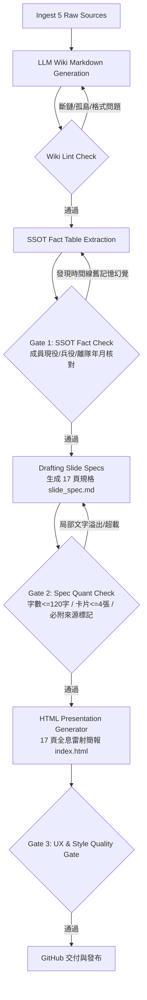

# Neo Culture Technology (NCT) LLM Wiki & Pedagogical Presentation Engine

> 本專案依據 Andrej Karpathy 的 LLM Wiki 架構與課堂講義（第 26 頁「Shift-Left：大圈很少轉，小圈轉得很快」與第 52 頁工程標準）建立，旨在將複雜的 NCT 男團體制轉譯為零基礎路人也能輕鬆理解的教學型 HTML 互動簡報。

---

## 🌟 成果連結快速導覽

- 🖥️ **教學型 HTML 簡報（共 17 頁完整版）**：[`presentation/index.html`](./presentation/index.html) 或直接以瀏覽器開啟。
- 📚 **LLM Wiki 核心知識庫**：
  - [體制核心說明 (`wiki/concepts/neo_culture_technology.md`)](./wiki/concepts/neo_culture_technology.md)
  - [各大分隊規格 (`wiki/units/`)](./wiki/units/)
  - [成員個人檔案共 27 篇 (`wiki/members/`)](./wiki/members/)
  - [重大演進時間線 (`wiki/timeline/system_timeline.md`)](./wiki/timeline/system_timeline.md)
  - [路人術語對照辭典 (`wiki/glossary/kpop_terms.md`)](./wiki/glossary/kpop_terms.md)
- 📝 **完整作業繳交報告（Markdown 格式，可直接貼入 Word 轉 PDF）**：[`report/final_report.md`](./report/final_report.md)
- ⚙️ **系統架構與防錯規範**：[`AGENTS.md`](./AGENTS.md)

---

## 💡 17 頁教學型 HTML 簡報章節綱要

| Slide 編號 | 章節標題 | 視覺主題風格 |
| :---: | :--- | :--- |
| **01** | 解碼 K-Pop 最前衛的男團品牌：什麼是 NCT？ | NCT 珍珠香檳綠全息雷射科技感 |
| **02** | 傳統偶像團體 vs NCT 顛覆體制 | 概念對比高對比網格 |
| **03** | 體制核心架構：品牌傘與多維矩陣 | 全息中樞網絡圖解 |
| **04** | NCT U：無固定編制的戰術先鋒 | 前衛流動雷射 |
| **05** | NCT 127：首爾經度上的先鋒本隊 | 首爾科技經度金屬風 |
| **06** | 代表作解構：*Fact Check* 不可思議 | 景福宮宮殿金色金屬與帝王級雷射 |
| **07** | NCT DREAM：為青春陪伴而生的少年隊 | 青春純粹街頭少年感 |
| **08** | 體制危機：爭議性的 20 歲「畢業制」 | 倒數警戒與破碎時鐘 |
| **09** | 代表作 *We Go Up* 與 2020 體制修正 | 街頭滑板少年、復古運動風與高飽和綠光 |
| **10** | WayV (威神V)：大中華戰略與跨文化開拓 | 深冷未來金屬與全球矩陣 |
| **11** | 代表作解構：*Turn Back Time* 超越時空 | 巨大鐘錶齒輪、時空倒流與深紅警報反差 |
| **12** | 體制重大轉折：SM 3.0 宣告結束無限擴張 | 體制封閉與系統邊界 |
| **13** | NCT WISH：無限擴張的治癒終章 | 東京巨蛋純白晨曦 |
| **14** | 代表作解構：*Steady* 清新青春應援 | 千禧 Y2K 美學、薄荷微光與幸運四葉草 |
| **15** | 全員集結：NCT 年度盛典大企劃 (2018-2023) | 黃金共振全體大碟 |
| **16** | 路人防迷航：三步看懂 NCT 必備手冊 | 速查手冊終端介面 |
| **17** | 幕後揭秘：雙重小圈防錯工程與 Shift-Left | 雙重小圈工程流線圖解 |

---

## 🛠️ Shift-Left 雙重小圈工程防錯架構



---

## 🚀 本地預覽指南

1. **直接開啟簡報**：
   在檔案總管中點擊 `presentation/index.html`，或在瀏覽器中開啟該檔案。
2. **驗證自動化檢查腳本**（PowerShell）：
   ```powershell
   # 檢查 Wiki 完整度與孤島頁面
   powershell -ExecutionPolicy Bypass -File scripts/lint_wiki.ps1

   # 執行 Gate 1: SSOT 事實核對
   powershell -ExecutionPolicy Bypass -File scripts/check_gate1_ssot.ps1

   # 執行 Gate 2: Slide Spec 17 頁量化防破版核對
   powershell -ExecutionPolicy Bypass -File scripts/check_gate2_spec.ps1
   ```
