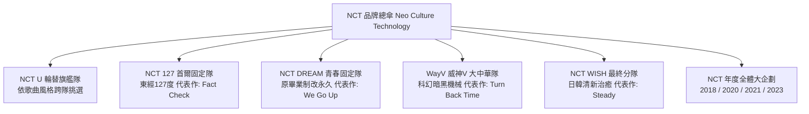

# Neo Culture Technology (NCT) 核心體制說明

## 1. 什麼是 NCT？
**NCT** 全稱為 **Neo Culture Technology（新文化技術）**，是由韓國 SM 娛樂於 2016 年創立的跨國大型男子團體品牌。

不同於傳統 K-Pop 偶像團體固定 4 至 9 人的編制，NCT 在誕生初期被賦予了兩大顛覆性規則：
1. **開放性（人數無上限）**：成員人數不設限制，隨時吸納全球各地新練習生加入。
2. **無限擴張性（分隊在地化）**：以首爾為起點，企圖向全球各大城市（如大中華區、東京、美洲、中東等）輸出專屬在地化小分隊。

---

## 2. 體制運作四大支柱

- **品牌傘架構**：所有小分隊均共享同一品牌與官方應援色 **Pearl Neo Champagne (珍珠香檳綠)**。
- **跨隊重疊特性**：部分成員可同時橫跨多個分隊（如 Mark 與 楷燦 同時活躍於 127 與 DREAM）。

---

## 3. 體制的重大修正與歷史演進
- **2020 年取消畢業制**：NCT DREAM 成功打破強制畢業規則，固定為 7 人體制。
- **2023 年宣告結束擴張（SM 3.0）**：正式宣告放棄無限擴張，日本隊 NCT WISH 成為體系內最後一支成立的分隊。

詳細歷史脈絡見：[[../timeline/system_timeline|體制發展重大時間線]]  
名詞解釋見：[[../glossary/kpop_terms|術語彙整表]]
